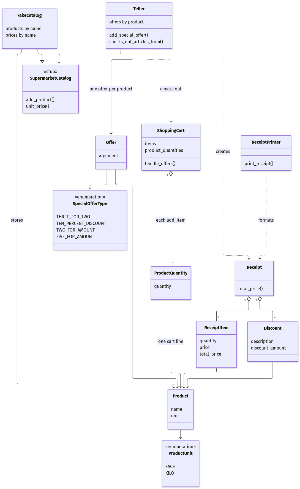
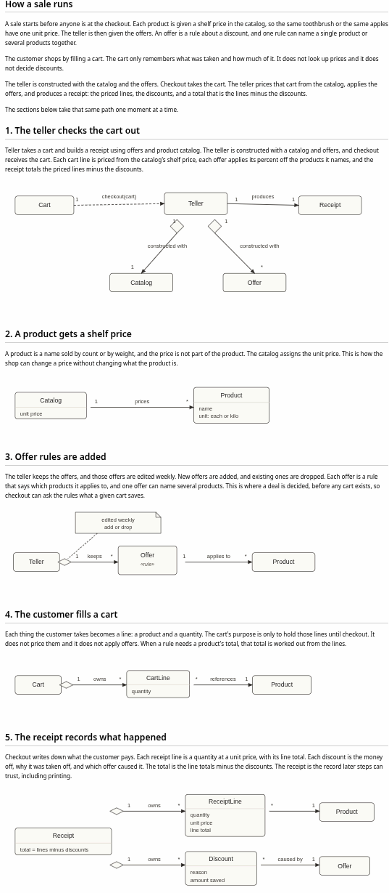

.. post:: 09 Nov, 2026
   :tags: python, kata, tdd, ai, software-design
   :category: python
   :author: Maksym Shalenyi
   :excerpt: 1
   :image: 0
   :nocomments:

TDD in age of LLM
=================

For over two decades, TDD has been one of the most powerful tools in software development. Its focus on breaking down the complexity of a codebase into abstractions with clear responsibilities, mapped to the domain, provides a way to express business rules through code. This has made it one of the leading practices in software development. However, in recent years, the advent of LLMs has been a game changer. Their ability to produce large amounts of code in a very short time, often more than can be thoroughly reviewed and validated, has pushed TDD and traditional approaches to software development into new and largely uncharted territory.

In this article, I will evaluate test-driven development in the context of LLM-assisted coding. I use TDD as a broad term encompassing traditional TDD, BDD, ATDD, SDD, and DDD as they are practiced in the software development industry. While these approaches differ, they have one thing in common: they use the domain as a lens through which to scope and structure the code. I share my experience and thoughts, along with some useful lessons learned as I explore LLM-assisted TDD by working through the Supermarket Receipt Refactoring Kata.

Supermarket Receipt Refactoring Kata
~~~~~~~~~~~~~~~~~~~~~~~~~~~~~~~~~~~~~

The `Supermarket Receipt Refactoring Kata <https://github.com/emilybache/SupermarketReceipt-Refactoring-Kata>`__ is a small supermarket checkout system that prices a cart, applies the week's discounts, and prints a receipt. The kata starts with poorly structured code, no tests, and a high-level description of the expected behavior. The goal is to add new features while keeping the existing behavior intact. This makes it a great exercise for trying different LLM-assisted coding approaches.

One of the most tangled parts of the code is the discount logic. Here is the original code:

.. code:: python

   class ShoppingCart:

      def handle_offers(self, receipt, offers, catalog):
         for p in self._product_quantities.keys():
               quantity = self._product_quantities[p]
               if p in offers.keys():
                  offer = offers[p]
                  unit_price = catalog.unit_price(p)
                  quantity_as_int = int(quantity)
                  discount = None
                  x = 1
                  if offer.offer_type == SpecialOfferType.THREE_FOR_TWO:
                     x = 3

                  elif offer.offer_type == SpecialOfferType.TWO_FOR_AMOUNT:
                     x = 2
                     if quantity_as_int >= 2:
                           total = offer.argument * (quantity_as_int / x) + quantity_as_int % 2 * unit_price
                           discount_n = unit_price * quantity - total
                           discount = Discount(p, "2 for " + str(offer.argument), -discount_n)

                  if offer.offer_type == SpecialOfferType.FIVE_FOR_AMOUNT:
                     x = 5

                  number_of_x = math.floor(quantity_as_int / x)
                  if offer.offer_type == SpecialOfferType.THREE_FOR_TWO and quantity_as_int > 2:
                     discount_amount = quantity * unit_price - (
                                 (number_of_x * 2 * unit_price) + quantity_as_int % 3 * unit_price)
                     discount = Discount(p, "3 for 2", -discount_amount)

                  if offer.offer_type == SpecialOfferType.TEN_PERCENT_DISCOUNT:
                     discount = Discount(p, str(offer.argument) + "% off",
                                          -quantity * unit_price * offer.argument / 100.0)

                  if offer.offer_type == SpecialOfferType.FIVE_FOR_AMOUNT and quantity_as_int >= 5:
                     discount_total = unit_price * quantity - (
                                 offer.argument * number_of_x + quantity_as_int % 5 * unit_price)
                     discount = Discount(p, str(x) + " for " + str(offer.argument), -discount_total)

                  if discount:
                     receipt.add_discount(discount)

The code has several smells and issues, including an incorrect total calculation caused by using ``/`` instead of ``//`` when calculating the number of qualifying offer groups:

.. code:: python

   total = offer.argument * (quantity_as_int / x) + quantity_as_int % 2 * unit_price

You may also rightly question why the ShoppingCart class is responsible for handling discounts, along with many other design decisions in the initial code. Which makes a core of the refactoring exercise. And might be LLM very helpful in spotting these smells and fixing design issues. However there is a fundamental question: should we even consider these smells as a reason to refactor the code in the first place in LLM age?

A place in the loop
~~~~~~~~~~~~~~~~~~~

I would argue that as long as we want to keep humans in the loop, we should treat these code smells and design issues as valid reasons to refactor, especially in the age of LLMs, and be even more aggressive about it. TDD, in the broad sense, is the way of keeping human in the loop while addressing complexity comprehension and typing speed limits.  The human's role in the loop is to define abstractions and provide domain-driven scoping, while the LLM assists with the implementation.

Simply prompting an LLM to write tests before writing the code, or asking it to follow a TDD approach, removes the human from the "loop" and leaves the LLM responsible for the code's design and architecture. This is not TDD. Just like running a team of agents, it's a way to get code written faster, but it doesn't necessarily develop deeper domain knowledge or expertise.

LLM-assisted Refactoring
~~~~~~~~~~~~~~~~~~~~~~~~

for this kata I will follow the following steps:

1. Understand domain, identify business rules, and the existing behavior.
2. Capture the existing behavior through high-level tests.
3. Refactor. Keep all existing tests passing.
4. Add new features.

Step 1: Understand domain
---------------------------

The ability of LLMs to process large amounts of text, explore an entire codebase, and provide a high-level overview of its design and business rules is extremely valuable, especially when working with unfamiliar or poorly documented legacy code.

However, this wasn't always straightforward, nor always accurate. LLMs would often dump everything they had gathered into one large block of information, without organizing it around the domain, distinguishing important business rules from implementation details, or providing a coherent picture of how the system actually works. The challenge wasn't so much gathering information as making sense of it.

What helped:

* Breaking the exploration into smaller, focused business rule focused chunks, rather than asking for a complete codebase overview in one prompt.
* Asking the LLM to identify business rules, domain concepts, and dependencies separately from implementation details.
* Requesting concrete examples and tracing specific business scenarios through the code.
* Challenging the results (are you really sure about that?) and verifying important findings by hand.

Step 2: Pinning down existing behavior with test
------------------------------------------------

LLMs tend to generate lots of low-level unit tests, often focusing on individual methods and implementation details, while overlooking the overall test structure and integration between components. 100% code coverage and 100% logical-case coverage aren't the same thing, and LLM overlooked it several times.

What helped:

* Identify business scenarios, and ask to cover them with tests via high-level interface
* Show test structure by an example, rather than just asking for it in a prompt
* Adding testing methods
* Split presentation layer from the domain layer, and test the domain layer first

.. code:: python

   def test_ten_percent_discount() -> None:
      toothbrush = Product("toothbrush", ProductUnit.EACH)

      catalog = InMemoryCatalog()
      catalog.add_product(toothbrush, 0.99)

      teller = Teller(catalog)
      teller.add_special_offer(SpecialOfferType.TEN_PERCENT_DISCOUNT, toothbrush, 10)

      cart = ShoppingCart()
      cart.add_item(toothbrush)

      receipt = teller.checks_out_articles_from(cart)

      assert receipt.to_dict() == {
         "items": [
               {
                  "product": "toothbrush",
                  "unit": "EACH",
                  "quantity": 1.0,
                  "price": 0.99,
                  "total_price": 0.99,
               },
         ],
         "discounts": [
               {
                  "description": "10% off",
                  "product": "toothbrush",
                  "discount_amount": -0.099,
               },
         ],
         "total_price": 0.891,
      }, "ten percent off should reduce the toothbrush line"

Step 3: Refactor. Keep all existing tests passing.
----------------------------------------------------------

This step is focused on improving the domain model and making code to reflect the business domain better. The goal is to make the code easier to understand and extend, so the human can be kept in the loop.

Similarly to how I used a LLM to explore the domain structure, I used it to build a new domain model. However, LLMs are not always reliable at understanding use cases or explaining how the different parts of the system fit together. LLMs tend to jump to conclusions and start implementing solutions before the problem and domain model are properly understood or developed. The more advanced the LLM, the more it eager to jump into writing a huge amount of code.

In practice, this often turned into two specification-driven development: I used the LLM to on domain desing specifications.

When I was happy with the domain model, I moved working on the implementation details specifications.

.. code:: 

   ## Product

   Spec: a name sold by count or by weight. The price is not part of the product.

   Responsibility: identify something the shop sells. It does not know a price, an offer, a cart, or a receipt.

   A frozen model:

   - `name: str`
   - `unit`: each or kilo

   No methods. Callers read `product.name` and `product.unit`. Frozen so the same product can be the key in the catalog.

What I learned about working with LLMs:

* Premature implementation: LLMs tend to jump straight into coding, sometimes producing a lot of work in the wrong direction before the domain and requirements are clear.
* Test drift: LLMs frequently modify existing tests to accommodate their implementation. This makes it easy to introduce slop or silently change the original expectations. Keeping the tests honest requires constant attention.
* Domain understanding: LLMs can describe code structures, but often struggle to explain the business rules and tell a coherent story about how the system works.
* Communication overhead: Explaining a design or desired change in natural language can be surprisingly difficult and time-consuming. Sometimes it's easier to write a small prototype and let the LLM adapt it than to explain the intended structure in a prompt.

What helped:

* Build domain model specifications first step by step, rather than all at once.
* Being explicit about preserving existing tests and their expectations. Never accepting a test change simply because it makes the implementation pass.
* Writing small prototypes or examples to communicate design intent when words aren't enough.
* Frequently checking whether the implementation is moving in the right direction rather than trusting the amount of work the LLM has produced.

Step 4: Add new features
------------------------

This was the most straightforward step at the end, even though it's the main focus of this post, because I've learned from the previous steps. I followed this workflow for LLM-assisted TDD:

1. Add specifications (Design / Domain). Identify where the feature belongs in the existing architecture/domain and create specifications for it.

2. Add high-level tests. Define acceptance criteria and write tests covering the main user flows and expected behavior.

3.Implement the feature. Work incrementally until the tests pass. Loop back to adding more tests when needed.

Adding new features didn't reveal anything new compared to the previous steps. I used the LLM to help me understand the new features and determine the best way to implement them. I also used it to write tests and implement the features.

A few things I noticed again:

* Premature implementation. Don't let the LLM start coding before it has finished working on the specifications and tests.
* Test drift. Don't let the LLM modify or remove existing tests just to make them pass.
* Communication overhead. It's easier to just write code and point the LLM to it than to explain the intent in a prompt.
